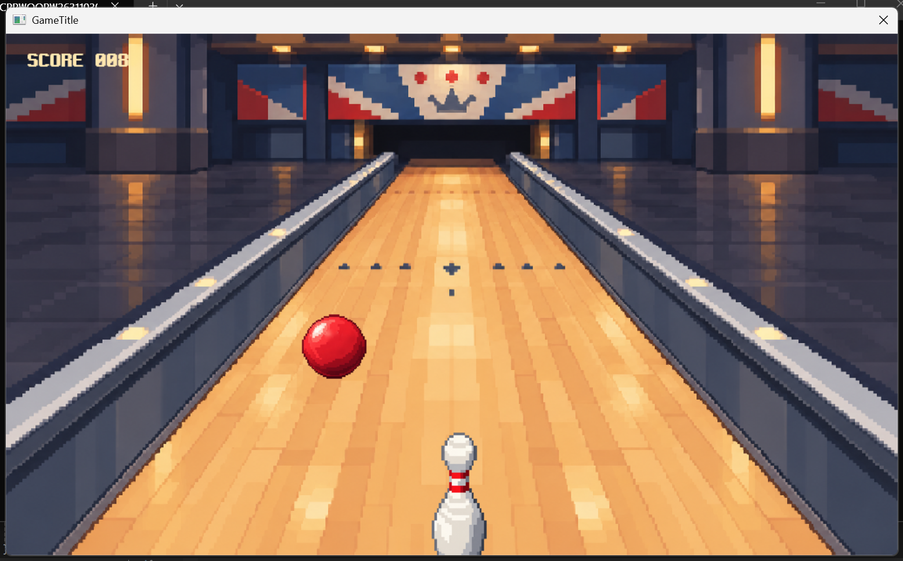
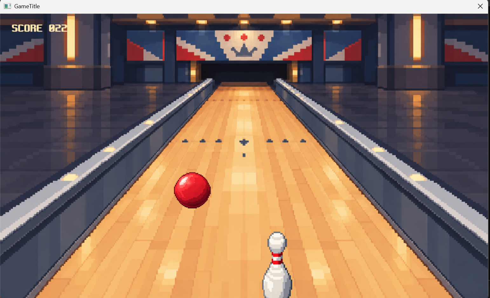
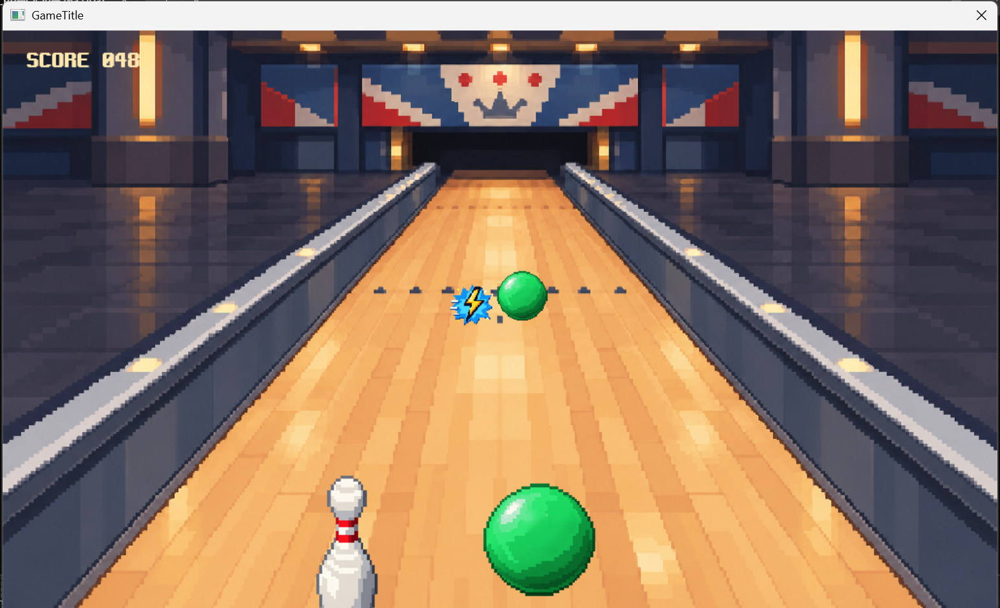
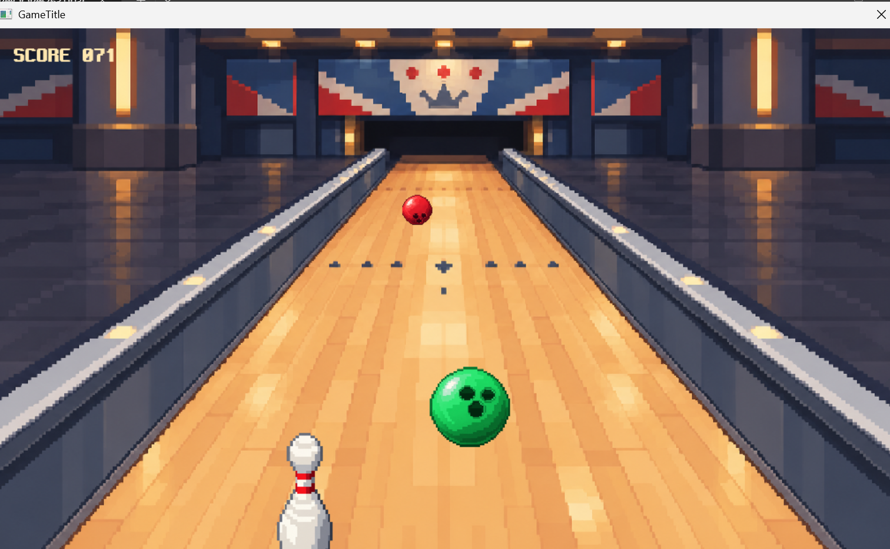

# 게임 기획서 — Last Pin

- 작성자: 박지환
- 작성일: 2026.10.15
- 수정일: 2026.11.09

## 1. 개요

- **장르:** 2D 생존 회피 아케이드
- **개발 환경:** Visual Studio 2022, C++, glc2d
- **게임 화면 크기:** 1024×600
- **참고 게임:** Last Stand One

플레이어는 볼링핀을 좌우로 움직여 다가오는 볼링공을 피하고, 아이템을 활용하며 최대한 오래 살아남는 것을 목표로 한다.


## 2. 시스템 기획 내용

### 기본 규칙

- 핀은 레인 안에서 좌우로 이동한다.
- 볼링공은 레인 먼 쪽에서 생성되어 플레이어에게 다가온다.
- 무적 상태가 아닐 때 공에 한 번 맞으면 게임오버가 된다.
- 생존 시간 1초당 1점이 증가한다.
- 게임오버 시 최종 점수를 표시하고 재시작할 수 있다.

### 아이템

| 아이템 | 효과 |
| --- | --- |
| 이동 속도 증가 | 5초간 이동 속도가 1.5배 증가한다. (구현) |
| 무적 | 최대 5초간 무적이 되며, 이동하면 즉시 해제된다. (예정) |
| 총 | 사격 기회 1회를 얻는다. 볼링공을 마우스로 직접 클릭해 파괴한다. (예정) |

총 아이템 획득 시 볼링핀의 이미지가 총 장착 모습으로 변경된다. 별도의 탄환은 생성하지 않으며, 마우스로 공을 직접 클릭해 맞히면 파괴 애니메이션을 재생한 뒤 해당 공을 제거한다. 사격 기회는 클릭 시 1회 소모된다. 아이템의 수치와 세부 규칙은 플레이 테스트를 통해 조정한다.

## 3. 플레이 방식

| 입력 | 동작 |
| --- | --- |
| 좌우 방향키 또는 A/D | 핀 좌우 이동 |
| 마우스 왼쪽 클릭 | 총 아이템 보유 시 볼링공을 직접 클릭해 파괴 (예정) |
| Enter | 게임 시작 또는 재시작 |
| ESC | 게임 중 일시정지·재개, 시작·결과 화면에서 종료 |

**진행 흐름:** 시작 화면 → 공 회피 및 아이템 활용 → 시간에 따른 난이도 상승 → 피격 및 게임오버 → 결과 확인 및 재시작.

## 4. 스테이지 구성

별도 맵 전환 없이 생존 시간에 따라 난이도가 높아지는 방식으로 구성한다.

| 단계 | 생존 시간 | 주요 내용 |
| --- | --- | --- |
| 1단계 | 0~10초 | 직진하는 공이 한 개씩 등장하며 기본 조작을 익힌다. |
| 2단계 | 10~30초 | 여러 개의 직진 공이 등장하며 생성 간격이 무작위로 변경된다. |
| 3단계 | 30~60초 | 커브 공을 추가하여 직진 공과 함께 등장한다. |
| 4단계 이후 | 60초 이후 | 여러 공의 조합과 더 짧아진 생성 간격으로 난이도를 높인다. |

볼링공의 생성 간격과 종류는 `SpawnManager`에서 관리한다. 피할 수 있는 공간을 남기도록 패턴을 구성한다. 공의 이동 패턴은 직진형과 커브형을 구현하였으며, 세 번째 패턴의 동작은 추후 확정한다.

## 5. 주요 객체 및 화면 표현

| 객체 | 역할 및 표현 |
| --- | --- |
| 플레이어 핀 | 좌우 이동, 아이템 사용, 피격 시 쓰러짐 |
| 볼링공 | 직진·커브 이동, 접근에 따른 확대, 굴러가는 애니메이션과 클릭 시 파괴 애니메이션 |
| 아이템 | 이동 속도 증가·무적·사격 기회 제공, 획득 효과 |
| 레인 | 먼 쪽은 좁고 가까운 쪽은 넓은 배경으로 거리감 표현, 좌우 가드레일 배치 |

핀의 이동·쓰러짐, 공의 회전과 파괴, 아이템 효과에 애니메이션 및 효과음을 적용한다.

## 6. UI 구성

- **시작 화면:** 게임 제목, 조작 방법, 시작 안내.
- **게임 화면:** 생존 시간에 따른 점수, 아이템 효과와 남은 시간. 총 사격 가능 여부는 추후 추가한다.
- **일시정지 화면:** ESC 입력 시 일시정지 안내를 표시하고, 다시 누르면 게임을 재개한다.
- **결과 화면:** 최종 점수, 재시작 안내.

## 7. 주요 클래스 구성

현재 구현한 구조를 기준으로 정리하였다. 향후 추가 아이템과 볼링공 패턴 구현 과정에서 일부 클래스가 추가될 수 있다.

| 구분 | 역할 및 구현 상황 |
| --- | --- |
| App | 초기화, 전체 흐름 및 Scene 전환·최종 점수 관리 (구현) |
| GraphicEngine | glc2d 초기화, 게임 창과 렌더링 관리 (구현) |
| GameTime | 프레임 간 경과 시간 관리 (구현) |
| GameInput | 키보드 입력 관리, 추후 마우스 입력 활용 (구현·확장 예정) |
| GameScene | 장면 공통 기능 및 배경·BGM 리소스 관리 (구현) |
| SceneBegin | 시작 화면, 제목 이미지, Enter 입력 및 안내문 깜빡임 (구현) |
| ScenePlay | 플레이어·볼링공·아이템 관리, 충돌·점수·일시정지 처리 (구현) |
| SceneResult | 게임오버 결과 화면 및 재시작 처리 (구현) |
| GameObject | 게임 객체 공통 위치·배율과 가상 함수 정의, 추상 클래스 (구현) |
| Character | GameObject 상속, 이동 속도와 공통 이동 함수 관리 (구현) |
| Player | Character 상속, 좌우 이동·범위 제한 및 속도 증가 효과 관리 (구현) |
| BowlingBall | GameObject 상속, 굴러가기 애니메이션·접근 이동·크기 변화 (구현) |
| StraightBall / CurveBall | BowlingBall을 기반으로 직진·커브 이동 패턴 구현 (구현) |
| Item | GameObject 상속, 아이템 이동·크기 변화 및 종류 관리 (구현) |
| SpawnManager | 생존 시간에 따른 볼링공·아이템 생성 및 난이도 관리 (구현) |
| CollisionManager | 플레이어와 볼링공·아이템 충돌 판정 (구현) |

### 클래스 상속 구조

현재 구현된 클래스 구조를 기준으로 정리하였다.

```text
GameObject
├── Character
│   └── Player
├── BowlingBall
│   ├── StraightBall
│   ├── CurveBall
│   └── OtherBall     (추가 검토)
└── Item
```

- **GameObject:** 위치, 배율 및 게임 객체의 공통 인터페이스를 정의하는 추상 클래스
- **Character:** 이동 속도와 이동 기능을 관리하는 클래스
- **Player:** 키보드 입력에 따른 플레이어 이동, 이미지 출력 및 속도 증가 효과 담당
- **BowlingBall:** 볼링공의 이동, 원근감, 스프라이트 애니메이션 담당
- **StraightBall / CurveBall:** 직진 및 커브 이동 패턴을 담당
- **Item:** 아이템 이동과 크기 변화 및 종류 관리 담당
- **SpawnManager:** 볼링공과 아이템 생성, 시간에 따른 난이도 변화 담당
- **CollisionManager:** 플레이어와 볼링공·아이템 충돌 판정 담당

`BowlingBall`의 공통 기능과 이동 패턴을 분리하여 상속 및 다형성을 활용하였다. 여러 볼링공과 아이템은 `std::vector`와 `std::unique_ptr`을 활용하여 관리한다.

## 8. 구현 범위

**현재 구현:** 원근감 있는 2D 화면, 좌우 이동, 복수 공 생성·충돌, 직진·커브 패턴, 시간에 따른 난이도 상승, 굴러가기 애니메이션, 생존 점수와 게임오버·재시작, 일시정지, 이동 속도 증가 아이템 및 효과 시간 표시.

**최종 보완:** 무적·총 아이템, 볼링공 직접 클릭 파괴, 파괴·피격 애니메이션, UI와 게임 밸런스 조정.

**추가 검토:** 기본 게임 완성 후 난이도에 따라 목숨 시스템 및 볼링공의 가드레일 반사 패턴 도입을 검토한다.

## 9. 주차별 개발 계획

| 구분 | 주요 작업 | Git Tag |
| --- | --- | --- |
| 1주차 | 프로젝트·Git 구성, 기획서 작성, 기본 실행 | f1 |
| 2주차 | 게임 리소스 수집 및 Scene·입력·시간 관리 기본 구조 구성 | f2 |
| 3주차 | 배경·BGM·플레이어 출력, 키보드 이동, 객체 상속 구조, 볼링공 1개 애니메이션·원근감·랜덤 이동 구현 | f3 |
| 4주차 | 복수 공 생성·패턴 분리, 충돌·게임오버·점수·난이도 상승 및 이동 속도 증가 아이템 구현 | f4 |
| 최종 보완 | 무적·총 아이템·사격 기능 완성 및 조정, 버그 수정, 실행·문서 점검 | fin |

## 10. 게임 리소스 목록

리소스는 `Texture`, `Sound`, `Font` 폴더로 구분하여 관리한다. 아래 파일명과 경로는 현재 프로젝트에 정리한 내용을 기준으로 한다.

### 10.1 이미지 (Texture)

| 구분 | 파일 경로 | 이미지 규격 | 용도 |
| --- | --- | --- | --- |
| 배경 | `Texture/Background/bg_lane.png` | 1024×600 | 볼링 레인 및 가드레일 배경 |
| 플레이어 | `Texture/Player/pin.png` | 256×256 | 기본 볼링핀 |
| 플레이어 | `Texture/Player/pin_gun.png` | 256×256 | 총 장착 볼링핀 |
| 볼링공 | `Texture/Ball/ball_red_roll.png` | 2048×256 | 빨간 공 굴러가기, 8프레임 |
| 볼링공 | `Texture/Ball/ball_green_roll.png` | 2048×256 | 초록 공 굴러가기, 8프레임 |
| 볼링공 | `Texture/Ball/ball_blue_roll.png` | 2048×256 | 파란 공 굴러가기, 8프레임 |
| 볼링공 | `Texture/Ball/ball_red_destroy.png` | 2048×256 | 빨간 공 파괴, 8프레임 |
| 볼링공 | `Texture/Ball/ball_green_destroy.png` | 2048×256 | 초록 공 파괴, 8프레임 |
| 볼링공 | `Texture/Ball/ball_blue_destroy.png` | 2048×256 | 파란 공 파괴, 8프레임 |
| 아이템 | `Texture/Item/item_speed.png` | 128×128 | 이동 속도 증가 |
| 아이템 | `Texture/Item/item_invincible.png` | 128×128 | 무적 |
| 아이템 | `Texture/Item/item_gun.png` | 128×128 | 총 획득 |
| UI | `Texture/Ui/title_logo.png` | 640×256 | 시작 화면 타이틀 |

볼링공 스프라이트 시트는 가로 8프레임이며 프레임당 256×256이다. 플레이어와 아이템 이미지는 필요에 따라 화면에 축소하여 출력한다. 이미지 리소스는 AI 이미지 생성 및 편집을 통해 제작하였다.

### 10.2 사운드 (Sound)

| 구분 | 파일 경로 | 용도 |
| --- | --- | --- |
| BGM | `Sound/BGM/bgm_play.mp3` | 게임 플레이 중 반복 재생 |
| 효과음 | `Sound/SFX/game_start.mp3` | 게임 시작 |
| 효과음 | `Sound/SFX/item_pickup.mp3` | 아이템 획득 |
| 효과음 | `Sound/SFX/gun_shoot.mp3` | 사격 클릭 |
| 효과음 | `Sound/SFX/ball_destroy.mp3` | 볼링공 파괴 |
| 효과음 | `Sound/SFX/game_over.mp3` | 게임오버 |

### 10.3 폰트 (Font)

| 파일 경로 | 용도 |
| --- | --- |
| `Font/neodgm.ttf` | 메뉴 안내, 점수, 생존 시간, 결과 화면 텍스트 |

## 11. 참고 자료 및 리소스 출처

- 참고 게임: https://www.y8.com/games/last_stand_one
- 게임 BGM (Pixel Party): https://pixabay.com/music/video-games-8-bit-music-no-copyright-background-instrumental-pixel-party-322342/
- 게임 시작음: https://pixabay.com/sound-effects/film-special-effects-gamestart-272829/
- 아이템 획득음: https://pixabay.com/sound-effects/film-special-effects-90s-game-ui-6-185099/
- 총 발사음: https://pixabay.com/sound-effects/film-special-effects-arcade-shot-152053/
- 공 파괴음: https://pixabay.com/sound-effects/film-special-effects-pixel-explosion-319166/
- 게임오버음: https://pixabay.com/sound-effects/film-special-effects-lose-sfx-365579/
- 이미지: ChatGPT 이미지 생성 및 편집을 활용해 제작
- 폰트: Neo둥근모 (neodgm.ttf, 라이선스 파일 포함)


## 12. 게임 실행 화면

### 12.1 0~10초



직진하는 공이 한 개씩 등장하며, 기본 조작을 익히는 구간이다.

### 12.2 10~30초



여러 개의 직진 공이 등장하며, 생성 간격이 무작위로 변경된다.

### 12.3 30~60초



직진 공과 커브 공이 함께 등장하며, 생성 간격이 더욱 짧아진다.

### 12.4 60초 이후



직진 공과 커브 공이 함께 등장하며, 생성 간격이 더욱 짧아져 난이도가 높아진다.


### 12.5 이동 속도 증가 아이템


아이템을 획득하면 5초간 이동 속도가 1.5배 증가한다. 오른쪽 상단에 아이템 이미지와 남은 시간이 표시된다.
